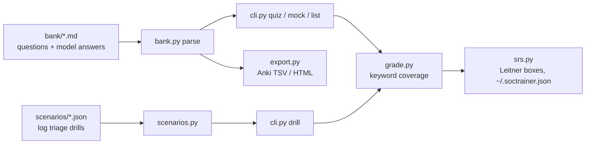

# SOC Interview Trainer

A study toolkit for SOC analyst interviews: a 71-question bank with model answers, a spaced-repetition quiz, timed mock interviews, log-triage drills with a true/false positive verdict, cheat sheets, and exports to Anki and a static flashcard page. Python standard library only (3.10+).

The answers are written in my own words for revision. Built with AI assistance. Five of the twelve drills use real log lines from the public OTRF Security-Datasets project (MIT, lab-generated, not employer data); the other seven are synthetic. Sources: `docs/real-sources.md`.

## Use it
```bash
python3 -m soctrainer list --domain windows       # browse questions
python3 -m soctrainer quiz -n 5                   # spaced repetition, due cards first
python3 -m soctrainer quiz --domain ir --level 2  # filter by domain and max level
python3 -m soctrainer mock -n 8 --seconds 90      # timed mock interview with keyword coverage
python3 -m soctrainer drill                       # random log-triage scenario
python3 -m soctrainer drill --id kerberoast-burst
python3 -m soctrainer stats                       # boxes, accuracy, weakest domains
python3 -m soctrainer export anki --out cards.tsv # import into Anki (tab separated)
python3 -m soctrainer export html --out cards.html
python3 -m unittest discover -s tests
```
Progress is saved to `~/.soctrainer.json` (change it with `--progress`).

## How it works
- **Bank** (`bank/*.md`): one Markdown file per area (fundamentals, windows, network, detection, incident response, linux/web/cloud, banking and fraud, behavioural). Each question has a domain, level 1-3, keywords and a model answer.
- **Grading**: your typed answer is checked for coverage of the keywords (plural tolerant, no substring false hits). It is a revision aid, not an AI judge, so read the model answer too.
- **Spaced repetition**: five Leitner boxes with intervals 0, 1, 3, 7 and 21 days. A correct answer moves a card up, a miss sends it back to box 1. Due and low-box cards come first.
- **Drills** (`scenarios/*.json`): twelve log excerpts (five from real OTRF telemetry), including false positives (Defender touching LSASS, a legitimate trip to the UAE) and a "needs more data" case. Score is 50% verdict, 50% reasoning keywords.
- **Cheat sheets** (`cheatsheets/`): Windows and Sysmon event IDs, ports, ATT&CK tactics, triage commands.

## Tests
22 tests, including quality checks on the bank itself: every model answer must cover all of its own keywords, question ids are unique, and every scenario scores 100% on its own explanation.

## Adding questions
Append a block to a file in `bank/`:
```
### Q: Your question?
- domain: windows
- level: 2
- keywords: term one, term two, term three
A: The model answer.
```
Then run the tests. They fail if the answer does not contain its keywords.

## Architecture


## Scope and limits
**Tested**
- 22 unit tests, including checks on the content itself (each model answer covers its own keywords, ids are unique, each scenario scores 100% on its own explanation). They run in GitHub Actions on push. I ran them locally on 26 Nov 2026: all pass.
- The quiz code and the consistency of the question bank and drills.

**Not tested**
- whether the model answers match any real interviewer's expectations, accuracy of every technical claim by an independent reviewer, or the keyword grader on free-form answers. Five of twelve drills use public OTRF telemetry, the rest are synthetic.

**Licence:** MIT, see `LICENSE`. Security reports: see `SECURITY.md`.
